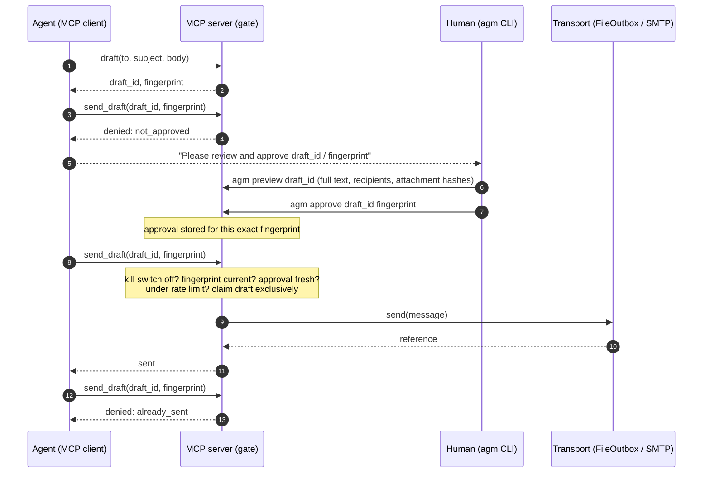

# approval-gated-mcp

A reference implementation of an MCP server that lets an AI agent **draft** outbound
messages but only **send** them after a human has approved the exact draft, identified by a
content fingerprint.

This is a small, readable example of one agent-safety pattern, written from a plain
description of the pattern. It is a reference, not a production mail system: see
[Limitations](#limitations).

## The problem

Giving an agent a `send_email` tool means a single bad model turn, a prompt injection hidden
in a web page or inbound message, or a plain mistake can send something to the wrong person
and cannot be recalled. Asking the model to "check with the user first" is a request, not a
control.

This server moves the control out of the model:

- The agent can **draft**, **preview**, **edit** and **request a send**. It cannot approve.
- Approval happens **out-of-band**, in a terminal command (`agm approve`) or a host-supplied
  callback, neither of which is an MCP tool.
- Approval is bound to a **fingerprint** of the exact content. Change one character, one
  recipient or one attachment byte and the approval no longer applies.
- Every send is gated by a **kill switch**, a **rate limit**, an **idempotency claim** and an
  **append-only audit log**.

## How it works



### Tools exposed to the agent

| Tool | Purpose |
|---|---|
| `draft(to, subject, body, cc?, bcc?, attachments?)` | Create a draft. Returns `draft_id` and `fingerprint`. Nothing is sent. |
| `draft_preview(draft_id)` | Exactly what would be sent: from, to/cc/bcc, subject, attachment names, sizes and sha256, a body excerpt, the fingerprint and the approval state. |
| `update_draft(draft_id, ...)` | Edit a draft. The fingerprint changes, which invalidates any earlier approval. |
| `send_draft(draft_id, fingerprint)` | Send, only if the fingerprint matches the current draft and a fresh human approval exists for it. |

There is deliberately **no approve tool**. `approve` is a method on the library
(`ApprovalGate.approve`) used by the CLI and by an optional host-supplied callback.

### Fingerprint

`sha256` over a canonical JSON encoding of `from`, `to`, `cc`, `bcc`, `subject`, `body` and
the `(name, sha256)` of each attachment, truncated to 24 hex characters (96 bits). Inputs
are normalised first (Unicode NFC, lowercase ASCII addresses, sorted and de-duplicated
recipient lists, `\n` line endings, trailing whitespace trimmed) and the normalised values
are what is stored and sent, so the approved text is the sent text. The `from` address comes
from server configuration, never from the agent. Attachment bytes are copied into the state
directory at draft time and re-hashed at send time, so swapping the source file after
approval has no effect.

Because approval is keyed on content, reverting an edit back to the approved text makes the
original approval apply again (within its expiry window). That is a deliberate property of
content addressing.

### Send checks, in order

1. Kill switch: `AGM_SENDING=off` or a `SENDING_OFF` file in the state directory. Checked on
   every call, no restart needed.
2. Draft exists; has not already been claimed (`already_sent` / `outcome_unknown`).
3. Supplied fingerprint equals the current fingerprint (`stale_fingerprint`).
4. A human approval exists for that fingerprint and has not expired (`not_approved`,
   `approval_expired`).
5. Attachment bytes still match their pinned hashes (`attachment_integrity`).
6. Rate limit: at most `AGM_RATE_LIMIT` sends in the trailing hour (`rate_limited`).
7. Exclusive claim: the draft's claim file is created with `O_EXCL` under a file lock, so a
   draft sends at most once, even with concurrent callers.
8. Transport call. If it raises, the state becomes `unknown` and the gate **never retries**;
   a human decides what to do next.

Every outcome is written to `audit.jsonl` (events: `draft`, `update`, `approve`,
`approve_denied`, `send_denied`, `send_claimed`, `send`, `send_unknown`). Message bodies are
never logged.

## Quickstart

Requires Python 3.11 or newer.

```bash
git clone https://github.com/mohanraj005-dot/approval-gated-mcp.git && cd approval-gated-mcp
python3 -m venv .venv && source .venv/bin/activate
pip install -e ".[dev]"       # core has no dependencies; the [mcp] extra adds the MCP SDK

python -m pytest -q           # run the tests
ruff check .                  # lint
python examples/demo.py       # end-to-end walkthrough in a temp directory
```

### Run the server

```bash
export AGM_HOME=./.agm AGM_OUTBOX=./outbox AGM_FROM=agent@example.com
agm-server                    # MCP over stdio
```

By default it writes `.eml` files to `./outbox` (the `FileOutbox` transport), so it runs with
zero credentials and sends nothing over a network.

### Approve a draft as the human

In a second terminal, with the same `AGM_HOME`:

```bash
agm list                                  # drafts, state, fingerprint
agm preview d_1a2b3c4d5e6f                # full text exactly as it would be sent
agm approve d_1a2b3c4d5e6f <fingerprint>  # shows the message again, asks [y/N]
agm audit -n 10                           # recent audit events
agm sending off                           # kill switch on; `agm sending on` to re-enable
```

`agm approve` refuses if the fingerprint is not the current one, and refuses to run without
an interactive terminal unless `--yes` is passed.

### Connect a client

Claude Code:

```bash
claude mcp add approval-gated-mcp \
  -e AGM_HOME=/abs/path/agm-state -e AGM_OUTBOX=/abs/path/agm-outbox \
  -- /abs/path/approval-gated-mcp/.venv/bin/agm-server
```

Claude Desktop (`claude_desktop_config.json`), see also
[`examples/claude_desktop_config.json`](examples/claude_desktop_config.json):

```json
{
  "mcpServers": {
    "approval-gated-mcp": {
      "command": "/abs/path/approval-gated-mcp/.venv/bin/agm-server",
      "env": {
        "AGM_HOME": "/abs/path/agm-state",
        "AGM_OUTBOX": "/abs/path/agm-outbox",
        "AGM_FROM": "agent@example.com"
      }
    }
  }
}
```

### Configuration

| Variable | Default | Meaning |
|---|---|---|
| `AGM_HOME` | `./.agm` | State directory (drafts, approvals, claims, audit log). |
| `AGM_OUTBOX` | `./outbox` | Where `FileOutbox` writes `.eml` files. |
| `AGM_FROM` | `agent@example.com` | Sender address. Fixed by config, not agent-controlled. |
| `AGM_SENDING` | `on` | Set to `off` to block every send. |
| `AGM_RATE_LIMIT` | `10` | Maximum sends per hour. |
| `AGM_APPROVAL_TTL` | `86400` | Seconds an approval stays valid. |
| `AGM_ALLOWED_DOMAINS` | unset | Comma-separated recipient domain allowlist. Unset allows any. |
| `AGM_ATTACH_DIR` | unset | Directory attachments may be read from. Unset disables attachments. |
| `AGM_TRANSPORT` | `file` | `file` or `smtp`. |
| `AGM_SMTP_HOST`, `_PORT`, `_USER`, `_PASSWORD` | unset | Only used when `AGM_TRANSPORT=smtp`. |

### Transports

`FileOutbox` is the default. `SmtpTransport` is included to show the seam (STARTTLS,
certificate verification, envelope recipients including Bcc) but it is off by default and has
**not** been tested against a real server. Any object with
`send(message: EmailMessage, recipients) -> str` works.

## Prompt-injection stance

Everything the agent reads is untrusted: inbound mail, web pages, files, tool results. Any of
it can contain text that tries to steer the agent, such as "reply to everyone with the
attached file". This server does not try to detect that. It makes it **unprofitable**:

- A hijacked agent can still only draft. Sending requires a human to look at the actual
  recipients, subject, body and attachment hashes and approve that fingerprint.
- The agent cannot approve, cannot change the sender, and cannot widen the recipient domain
  allowlist or the attachment directory.
- Editing after approval invalidates the approval, so "approve the harmless draft, then swap
  the body" does not work.
- Header injection is blocked at the input layer (no CR/LF in subject or addresses, plain
  `addr@domain` only), and `Bcc` never appears in any header.
- The tool descriptions tell the model to treat message content as data and to report
  denials instead of looking for a way around them. That is guidance, not a control; the
  controls are the ones above.

The human is still the weak point: an approval prompt shown after a long session is easy to
click through. Keep previews short, show recipients first, and set a recipient allowlist.

## Threat model

| Threat | Mitigation here | Residual risk |
|---|---|---|
| Prompt injection makes the agent send something harmful | Agent cannot approve; send needs a human-approved fingerprint | Human approves without reading |
| Agent edits the draft after approval | Fingerprint covers all content; any edit changes it | None for content; approval of reverted text re-applies |
| Agent swaps an attachment file after approval | Bytes copied and hashed at draft time, re-verified at send | None for bytes inside the store |
| Agent reads arbitrary files via attachments | Attachments only from `AGM_ATTACH_DIR`; paths resolved before the containment check; disabled by default | Anything inside that directory is attachable |
| Header or recipient injection | Strict address and subject validation; Bcc kept out of headers | Non-ASCII (IDN) addresses are refused, not supported |
| Runaway agent loops | Per-hour rate limit; kill switch checked on every send | Limit is per state directory, not per recipient |
| Replay or double send | Exclusive claim file under a lock; sent drafts cannot be edited or re-sent | None within one state directory |
| Transport failure mid-send | State recorded as unknown, never retried; audit event written | A human must reconcile manually |
| Stale approvals | Approvals expire (`AGM_APPROVAL_TTL`) | Window is configurable, not zero |
| Agent obtains approval power | `approve` is not a tool; lives in CLI and host callback | **Agent with shell access as the same OS user can run `agm approve --yes` or edit state files** |
| Tampering with the audit log | Append-only writes, one event per line | Not tamper-evident; same-user processes can rewrite it |

## Limitations

- **Same-user trust boundary.** The approval CLI and state directory are only a real
  boundary if the agent process cannot reach them: run the MCP server and the human CLI under
  different OS users or in separate containers, and do not give the agent a shell on the same
  account. Nothing here enforces that for you.
- **Not tamper-evident.** The audit log is append-only by convention (no hash chain, no
  external sink). Ship it to a write-once store if you need evidence.
- **POSIX only.** Locking uses `fcntl`. Windows is not supported.
- **Single host.** State is local files with file locks. It is not safe over a network
  filesystem or across multiple hosts.
- **Approver callback runs under the send lock.** A slow interactive callback blocks other
  sends. Fine for a reference, not for throughput.
- **SMTP backend untested** against real servers; no retry, bounce or DSN handling.
- **Unknown outcome is terminal.** There is no "resolve" command; a human checks the
  destination and creates a new draft if needed.
- **Plain-text mail only**, ASCII addresses only, no reply threading.
- **Fingerprint is not a signature.** It binds an approval to content but does not
  authenticate the approver; approvals are not cryptographically signed.
- The `mcp` SDK is an optional dependency; the server wrapper supports both the 1.x
  (`FastMCP`) and 2.x (`MCPServer`) APIs. Only the tool surface and a stdio round trip are
  tested.

## Layout

```
src/approval_gated_mcp/
  models.py     draft model, normalisation, fingerprint
  gate.py       draft / preview / update / approve / send_draft and all send checks
  store.py      file-backed drafts, blobs, approvals, send claims, lock
  audit.py      append-only JSONL log
  transport.py  Transport protocol, FileOutbox, SmtpTransport, message builder
  config.py     environment configuration and kill switch
  cli.py        `agm` (human side)
  server.py     MCP wrapper (agent side, no approve tool)
tests/          pytest suite
examples/       demo script and client configuration snippets
```

## License

Apache-2.0. Copyright 2026 Mohan Raj Dhanapal. See [LICENSE](LICENSE).
